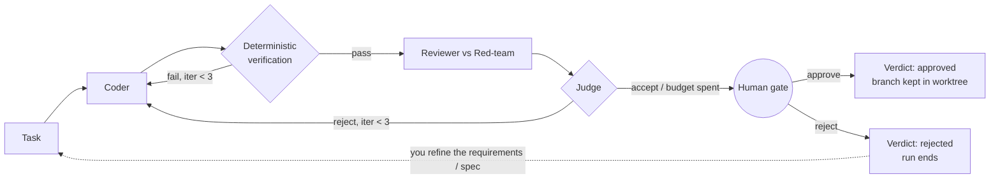
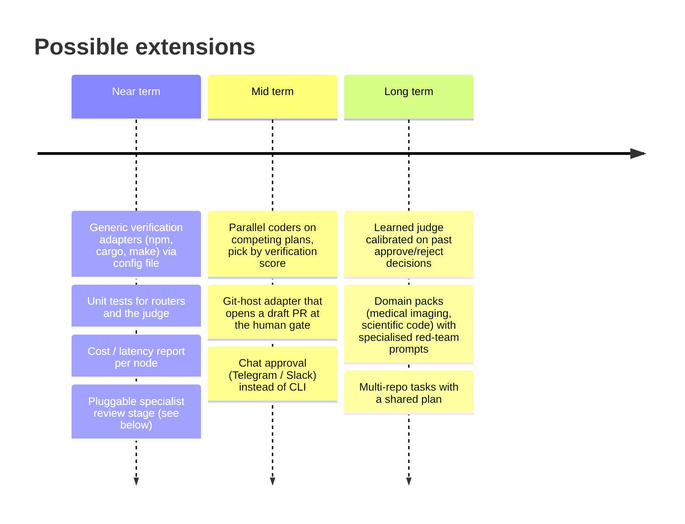

<p align="center"></p>

<h1 align="center">opencode-langgraph-loop</h1>
<p align="center"><b>A local-first, human-gated autonomous coding loop.</b><br>
LangGraph orchestrates; OpenCode agents write the code; deterministic checks verify the result; a human has the final say.</p>

<p align="center">


</p>

## The problem

Leaving an LLM agent to edit a real repository unattended usually fails in three predictable ways:

| Failure | What goes wrong | What this project does |
|---|---|---|
| **Self-certification** | The agent that wrote the code also claims it works. | Only a **deterministic** step (build + tests) decides pass or fail. LLMs only advise. |
| **Unbounded blast radius** | Destructive or leaky commands (`rm -rf`, `git push`, leaked `.env`, `sudo`). | Best-effort `permission` deny-rules in `opencode.json`, plus an isolated **git worktree** per run. This is a guardrail, **not a sandbox** (see [Known security limitations](#known-security-limitations)). |
| **Runaway loops & cost** | Infinite retries, wasted tokens, and reliance on paid cloud APIs. | Capped at 3 iterations, running entirely on **local models** via Ollama. |

The goal is a loop you can leave running: it either produces a verified changeset or stops and escalates to you. See the [known security limitations](#known-security-limitations) before trusting it with anything sensitive.

## How it works

<p align="center"></p>

1. **Worktree** – Each task runs in a fresh `git worktree`, leaving your working copy untouched.
2. **Planner → Coder** – A small model drafts a plan; the coder (`opencode run --auto`) edits the files.
3. **Post-process + Preflight** – Mechanical cleanup followed by a fast LLM triage. Obvious mistakes bounce straight back to the coder before running an expensive build.
4. **Verification** – Runs `cmake` + `pytest` (or your custom commands). **This is the single source of truth.**
5. **Adversarial review** – A *proposer* flags potential issues, a *red-team* agent tries to disprove them, and a *deterministic judge* aggregates the surviving findings. No single model can approve or block a change on its own.
6. **Human gate** – `interrupt()` pauses execution (with state saved in SQLite) until you `approve` or `reject`. The verdict is recorded and the run ends. Approving leaves the change on its branch in the worktree for you to merge; rejecting does not restart the loop. Instead, you use the error or the rejection to sharpen the **requirements and specification** (acceptance criteria, constraints, expected behaviour, files in scope) and start a fresh run with them. In practice, better specs improve the result far more than re-prompting does; `--spec` carries that context into the run. If the loop hits its 3-iteration limit, it escalates to you instead of guessing.



### Trust model

| Layer | Who | Authority |
|---|---|---|
| Opinion | planner, coder, proposer, red-team (LLMs) | None – advisory only |
| Truth | build, tests, judge (code) | Decides pass / fail |
| Decision | you | Final merge |

## What you can integrate

- **Any repo with a build/test command** – Update `CMAKE_FLAGS` and the pytest path in `graph/workflow.py`. Built and tested against a C++/Qt6 codebase ([ASAP](https://github.com/RiMoMa/ASAP)) with Python scripts.
- **Any OpenAI-compatible endpoint** – Declare models in `opencode.json` and override individual roles via `GRAPH_MODEL_PROGRAMADOR`, `GRAPH_MODEL_REVISOR`, `GRAPH_MODEL_REVISOR_REDTEAM`, `GRAPH_MODEL_PLANNER`, and `GRAPH_MODEL_PREFLIGHT`.
- **LangGraph Studio / API** – `langgraph dev` serves the compiled graph (`graph/workflow.py:graph`) with partial input (`{"task": "..."}`), streaming, and resumable threads.
- **Custom approval channels** – Because the human gate is a standard LangGraph `interrupt()`, you can resume runs from the CLI, Studio, or any client calling the LangGraph API.
- **CI & schedulers** – `python graph/run.py "<task>"` runs as a standard process, and SQLite checkpoints make interrupted runs easy to resume.

## Quick start

```bash
pip install -r requirements.txt
ollama serve                                    # models listed in opencode.json
langgraph dev                                   # Studio + API, graph id: "asap"
python graph/run.py "<task>"                    # or run from the CLI
python graph/run.py --resume <thread>           # continue a paused run
```

| Variable | Purpose | Default |
|---|---|---|
| `GRAPH_PYTHON` | Python interpreter used for `pytest` | current `python` |
| `GRAPH_DB` | SQLite checkpoint file, or `:memory:` | `./checkpoints.db` |
| `GRAPH_MODEL_*` | Per-role model ID override | `local-ollama/gemma4-26b-64k` |

Run commands from the root of your **target repository**. To use your own build and test steps, edit `CMAKE_FLAGS` and the test path in `graph/workflow.py`.

## Safety rails (`opencode.json`, best-effort)

Every agent is blocked from running or accessing: `sudo`, `git push`, `git reset --hard`, `git clean`, `git filter-*`, `git branch -D`, `gh repo`/`gh pr create`/`gh release`, `curl|sh`, `rm -rf /` and `~`, `mkfs`, `dd`, `shred`, reading `*.env` and `*.ssh*`, interactive prompts, and directories outside the worktree.

## Known security limitations

Reviewed on 2026-11-23. None of these issues are fixed yet; they are documented here so they can be addressed before running this loop on untrusted code. Treat the current rules as guardrails against accidental mistakes, not protection against a malicious repository or prompt injection.

| # | Limitation | Why it matters | Planned fix |
|---|---|---|---|
| 1 | **Deny-list can be bypassed.** `bash` is set to `"*": "allow"` with a blocklist, so equivalent commands can slip through (`git -C . push`, `bash -c "..."`, `rm -r -f`, file-deleting scripts, or obfuscated paths like `.s""sh`). | Stops common accidents, not a confused or compromised agent. | Switch to `"*": "deny"` with an explicit allow-list (`git status/diff/add/commit`, build/test commands, and read-only tools). |
| 2 | **No network isolation.** Only `curl \| sh`-style pipe patterns are blocked; commands like `curl -d @file https://...` are still allowed. | A prompt injection hidden in the target repo could exfiltrate files. | Run agents without network access (`unshare -n`, `bwrap --unshare-net`, or a container), exposing only `localhost:11434` for Ollama. |
| 3 | **Full environment inheritance.** Both `agent.py` and the `pytest` step pass `os.environ` directly to child processes. | Secrets in your shell (such as `GITHUB_TOKEN` or cloud API keys) are readable by the agent. | Pass a minimal environment (`PATH`, a temporary `HOME`, and `PWD`). |
| 4 | **`--auto` approves anything not explicitly denied**, and directory containment relies on OpenCode enforcing `external_directory: deny` (which has not been tested against raw shell commands). | Any gap in the deny-list is automatically approved. | Add an integration test that attempts to escape the worktree and fails the build if it succeeds. |

Until these are resolved: only run the loop on repositories you trust, use a disposable checkout, and keep sensitive credentials out of the shell environment.

## Roadmap & extension ideas



### Specialist code-review stage (planned)

Currently, the review step relies on general-purpose local models. We plan to add a **pluggable review node** that runs specialized reviewers and feeds their findings into the existing red-team → judge pipeline:

- **Hybrid reviewers** like [alibaba/open-code-review](https://github.com/alibaba/open-code-review) (Apache-2.0): combines deterministic rule pipelines with an LLM agent, line-level comments, and built-in rulesets (null-pointer, thread-safety, XSS, SQL injection). Running these *before* the LLM proposer catches straightforward issues early and cheaply.
- **Fine-tuned code-review models** served via Ollama and selected by language or domain, replacing the single generic model across all roles.
- **Static analyzers** (`clang-tidy`, `ruff`, `semgrep`) wrapped as graph nodes so the judge can weigh linter output alongside LLM findings using a unified evidence format.
- **Ensemble scoring**: multiple independent reviewers vote, escalating to the human gate whenever they disagree.

Throughout all of this, the judge remains deterministic: specialist reviewers contribute evidence, never final approval.

Contributions and ideas are welcome. The core graph is intentionally compact (~650 lines), so adding features means wiring in a new node or edge rather than rewriting the framework.

## Proven on a real codebase

This loop was built while developing a fork of [ASAP](https://github.com/RiMoMa/ASAP) (a C++/Qt6 digital pathology viewer with Python tooling). Work on that fork under this workflow includes:

- **`DetectionToolBase`**: extracted shared logic from the Gland and U-Net detection tools and added **non-blocking detection** so the GUI stays responsive during model inference.
- **`detect_common.py`**: consolidated duplicate FOV scripts into a single shared module.
- **`DetectionConfigDialog`**: added a configuration dialog for detection models with an adjustable `downscale` parameter.
- **Qt6 fixes**: updated LUT signal connections via `QOverload`, added LUT metatype registration, improved Fusion style and dark-palette detection, and applied a global QSS stylesheet.
- **Tests and build**: added unit tests for `xml_utils` and fixed OpenSlide header discovery in CMake.

## Status

**Beta.** The loop runs end to end and has been used for real development on ASAP. Open work before a 1.0:

- Automated tests for the graph (routers, judge, verification parsing).
- Closing the [known security limitations](#known-security-limitations).

You launch it from a shell with a task (and optionally a spec); everything after that flows through the LangGraph pipeline.

## License

GPL-2.0 – see [LICENSE](LICENSE).
