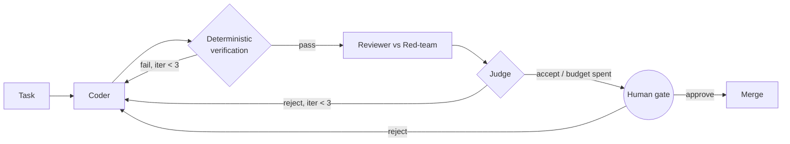
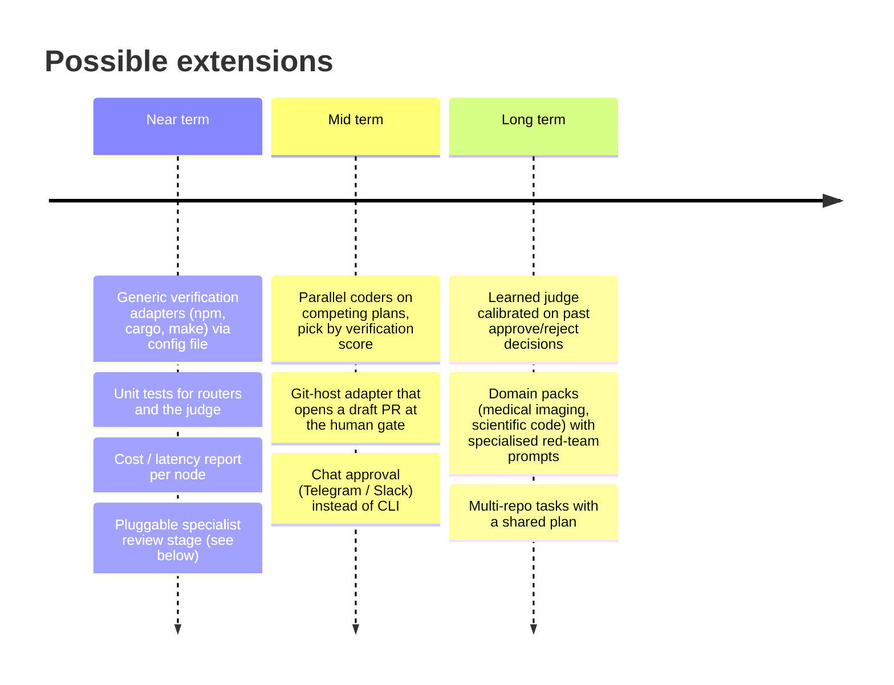

<p align="center"></p>

<h1 align="center">opencode-langgraph-loop</h1>
<p align="center"><b>A local-first, human-gated autonomous coding loop.</b><br>
LangGraph orchestrates; OpenCode agents write code; deterministic checks decide what is true; a human has the last word.</p>

<p align="center">


</p>

## The problem

Letting an LLM agent edit a real repository unattended fails in three predictable ways:

| Failure | What goes wrong | What this project does |
|---|---|---|
| **Self-certification** | The agent that wrote the code also says "it works". | Only a **deterministic** step (build + tests) can declare pass/fail. LLMs are advisory. |
| **Unbounded blast radius** | `rm -rf`, `git push`, leaked `.env`, `sudo`. | Hard `permission` deny-rules in `opencode.json`, plus an isolated **git worktree** per run. |
| **Runaway loops & cost** | Retries forever, burns tokens, needs a cloud API. | Bounded iterations (max 3), everything runs on **local models** through Ollama. |

The result is a loop you can leave running and still trust: it either produces a verified change set, or it stops and escalates to you.

## How it works

<p align="center"></p>

1. **Worktree** – the task runs in a fresh `git worktree`, never in your working copy.
2. **Planner → Coder** – a small model plans; the coder (`opencode run --auto`) edits files.
3. **Post-process + Preflight** – mechanical clean-up and a cheap LLM triage; obvious problems bounce straight back to the coder and skip the expensive build.
4. **Verification** – `cmake` + `pytest` (or your own commands). **This is the single source of truth.**
5. **Deliberative review nest** – a *proposer* raises findings, a *red-team* agent tries to refute them, and a *deterministic judge* aggregates. No single model gets to approve or block.
6. **Human gate** – `interrupt()` pauses the graph (state persisted in SQLite). You `approve` or `reject`; if the loop exhausted its 3 iterations it escalates instead of pretending.



### Trust model

| Layer | Who | Authority |
|---|---|---|
| Opinion | planner, coder, proposer, red-team (LLMs) | none – they suggest |
| Truth | build, tests, judge (code) | decides pass / fail |
| Decision | you | final merge |

## What it lets you integrate

- **Any repo with a build/test command** – swap `CMAKE_FLAGS` and the pytest path in `graph/workflow.py`. It was developed against a C++/Qt6 codebase ([ASAP](https://github.com/RiMoMa/ASAP)) with Python scripts.
- **Any OpenAI-compatible endpoint** – models are declared in `opencode.json`; per-role overrides with `GRAPH_MODEL_PROGRAMADOR`, `GRAPH_MODEL_REVISOR`, `GRAPH_MODEL_REVISOR_REDTEAM`, `GRAPH_MODEL_PLANNER`, `GRAPH_MODEL_PREFLIGHT`.
- **LangGraph Studio / API** – `langgraph dev` exposes the compiled graph (`graph/workflow.py:graph`), with partial input (`{"task": "..."}`), streaming and resumable threads.
- **Your own approval channel** – the gate is a plain `interrupt()`; resume it from the CLI, Studio, or any client that can call the LangGraph API.
- **CI / schedulers** – `python graph/run.py "<task>"` is a plain process; checkpoints in SQLite make it restartable.

## Quick start

```bash
pip install -r requirements.txt
ollama serve                                    # models listed in opencode.json
langgraph dev                                   # Studio + API, graph id: "asap"
python graph/run.py "<task>"                    # or run from the CLI
python graph/run.py --resume <thread>           # continue a paused run
```

| Variable | Purpose | Default |
|---|---|---|
| `GRAPH_PYTHON` | interpreter used for `pytest` | current `python` |
| `GRAPH_DB` | SQLite checkpoint file, or `:memory:` | `./checkpoints.db` |
| `GRAPH_MODEL_*` | per-role model id | `local-ollama/gemma4-26b-64k` |

Run it from the root of the **target repository**. Adapt verification by editing `CMAKE_FLAGS` and the test path in `graph/workflow.py`.

## Safety rails (`opencode.json`)

Denied for every agent: `sudo`, `git push`, `git reset --hard`, `git clean`, `git filter-*`, `git branch -D`, `gh repo`/`gh pr create`/`gh release`, `curl|sh`, `rm -rf /` and `~`, `mkfs`, `dd`, `shred`, reading `*.env` and `*.ssh*`, interactive questions and directories outside the worktree.

## Roadmap & extension ideas



### Specialist code-review stage (planned)

Today the review nest uses general-purpose local models. The plan is to add a **pluggable review node** that delegates to purpose-built reviewers and feeds their findings into the same red-team → judge pipeline:

- **Hybrid reviewers** such as [alibaba/open-code-review](https://github.com/alibaba/open-code-review) (Apache-2.0): deterministic rule pipelines plus an LLM agent, line-level comments and built-in rulesets (null-pointer, thread-safety, XSS, SQL injection). Their findings would run *before* the LLM proposer, so cheap, precise checks come first.
- **Code-review fine-tuned models** served through Ollama, selected per language or domain, instead of one generic model for every role.
- **Static analysers** (clang-tidy, ruff, semgrep) wrapped as nodes, so the judge weighs tool output and LLM opinion with the same evidence format.
- **Ensemble scoring**: several independent reviewers vote; disagreement is what gets escalated to the human gate.

The judge stays deterministic: specialist reviewers add evidence, they never get final authority.

Contributions and ideas are welcome. The graph is deliberately small (≈ 650 lines) so each of these is a node or an edge, not a rewrite.

## Proven on a real codebase

The loop was built while developing the [ASAP](https://github.com/RiMoMa/ASAP) fork (a C++/Qt6 digital-pathology viewer with Python tooling). Work on that fork under this workflow includes:

- **`DetectionToolBase`** extracted from the Gland and U-Net detection tools, and **non-blocking detection** (the GUI no longer freezes while a model runs).
- **`detect_common.py`**: the duplicated FOV scripts merged into one module.
- **`DetectionConfigDialog`** for configuring the detection models, plus a configurable `downscale`.
- **Qt6 fixes**: LUT connections via `QOverload`, LUT metatype registration, Fusion style and dark-palette detection, and a global QSS stylesheet.
- **Tests and build**: unit tests for `xml_utils` and OpenSlide header discovery in CMake.

## Status

Experimental. The graph itself has no automated tests yet. Prompts are written in Spanish; they are plain strings in `graph/workflow.py`, work with the multilingual local models used here, and can be edited or translated freely.

## License

GPL-2.0 – see [LICENSE](LICENSE).
